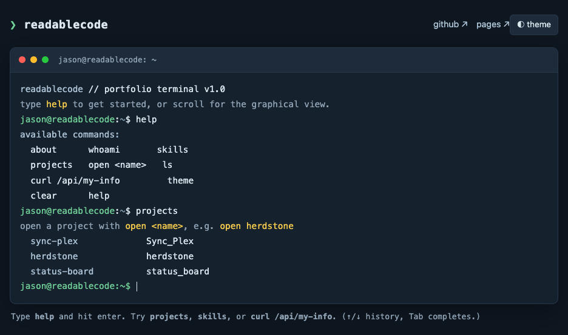
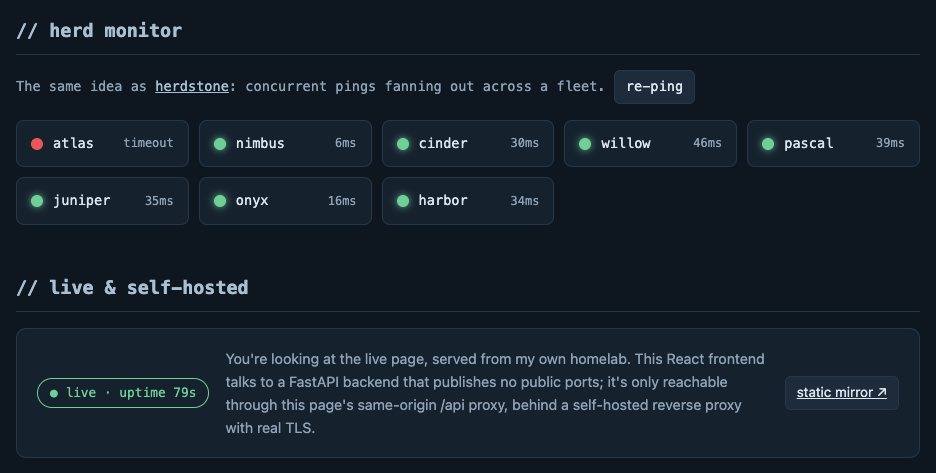
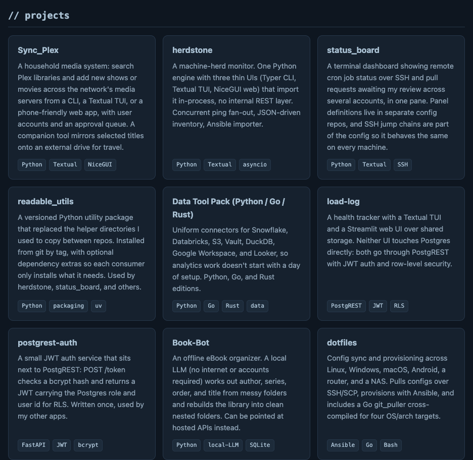

# website

My personal portfolio site, self-hosted on my homelab and served live at
[site.tinkernet.me](https://site.tinkernet.me).

It is a small two-container app: a React frontend that looks and behaves like a
terminal, and a FastAPI backend that serves the project list, a plaintext bio,
live CPU temperatures from the machine serving the request, and a full
plaintext edition of the site for `curl`. It exists to show my projects, and to
show that the page itself is a running service rather than a static export.



## What the site does

- **In-browser terminal.** Type `help` to navigate. Commands: `about`,
  `whoami`, `skills`, `projects`, `open <name>`, `ls`, `curl /api/my-info`,
  `theme`, `clear`, `help`. Up/down arrows walk the history and Tab completes.
  `curl /api/my-info` fetches the bio from the live backend.
- **Herd monitor.** A herdstone-style concurrent-ping display. It is a
  client-side simulation: eight placeholder nodes get random latencies or
  timeouts each time you press `re-ping`. No real hosts are pinged.
- **Live badge.** Calls `/api/status` and shows the backend's uptime, which is
  the proof the page is dynamically served from my own homelab. If the API
  does not answer within 4 seconds the badge falls back to "self-hosted".
- **Project cards and skills.** Cards are rendered from the backend's
  `/projects`. If the API is unreachable, the frontend uses the bundled copy in
  `frontend_react/src/data.ts`.
- **Light/dark theme**, remembered in `localStorage`.





### From a terminal

```bash
curl https://site.tinkernet.me/curl            # the whole site as plaintext
curl https://site.tinkernet.me/api/my-info     # bio and project list
curl https://site.tinkernet.me/api/temp        # live CPU temps (?format=json for JSON)
```

## Architecture

- **`frontend_react/`** - React 19 + Vite + TypeScript. Built to static assets
  and served by nginx. Its nginx also reverse-proxies `/api/` to the backend on
  the internal Docker network, so the browser only ever talks to one origin.
- **`backend/`** - FastAPI (uv), Python 3.13. Endpoints:
  - `/status` - uptime, plaintext
  - `/ping` - health check, JSON
  - `/projects` - featured projects, JSON (the frontend renders its project
    cards from this)
  - `/my-info` - bio and projects, plaintext
    (`curl https://site.tinkernet.me/api/my-info` to read my bio from the
    terminal)
  - `/temp` - live CPU temps of the serving hardware, read from the host's
    sysfs (`/sys/class/hwmon`, falling back to `/sys/class/thermal`)
  - `/curl` - a full plaintext edition of the site, proxied at the root so
    `curl https://site.tinkernet.me/curl` works without the `/api` prefix

  The backend publishes no host ports. It is only reachable through the
  frontend's `/api` proxy, never directly from the internet, so there is no
  CORS surface to widen.

The project list lives in two places that are kept in sync by hand:
`PROJECTS` in `backend/src/main.py` and `frontend_react/src/data.ts`. The
profile README and the GitHub Pages mirror carry the same blurbs.

## Running it locally

Backend (port 8002):

```bash
cd backend
uv run uvicorn src.main:app --host 0.0.0.0 --port 8002
curl localhost:8002/status
```

On a machine with no Linux sysfs sensors (macOS, some VMs), `/temp` reports
that no sensors are visible.

Frontend dev server:

```bash
cd frontend_react
npm install
npm run dev
```

The Vite dev server has no `/api` proxy, so in dev mode the page uses its
bundled project list and bio and the badge shows "self-hosted". To see the
frontend talk to the backend, run both containers so nginx does the proxying:

```bash
docker compose --project-directory . -f deploy/compose.elitedesk.yaml up --build
# then open http://localhost:8082
```

More detail, including plain `docker build` / `docker run` commands for each
half, is in [backend/README.md](backend/README.md) and
[frontend_react/README.md](frontend_react/README.md).

## Deploy

Built and run via the self-hosted Docker Compose stack behind a SWAG reverse
proxy (single `site.tinkernet.me` origin). The service definitions are in
`deploy/`; the homelab's main compose file pulls them in with `include:`. The
frontend container listens on port 8082 for the reverse proxy; the backend has
no published ports. Push to `master` and it auto-deploys.

## Related

- GitHub profile: <https://github.com/ReadableCode>
- Static mirror (GitHub Pages): <https://readablecode.github.io>
